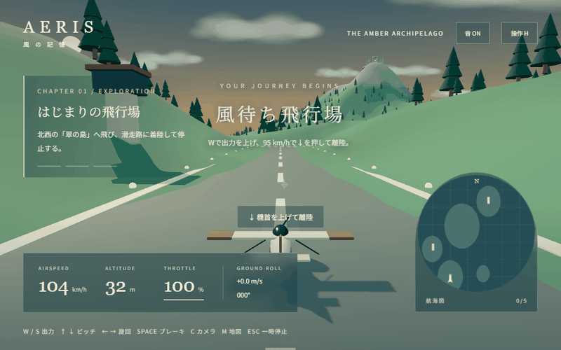

# AERIS — 風の記憶

夕暮れの群島を旅する、オリジナルのブラウザ用3Dフライトアドベンチャー。滑走路でエンジンを吹かし、山々の上を飛び、忘れられた聖域と秘密の飛行場を発見します。



デモは実際のWebGLゲーム画面を12秒分収録したものです。離陸・山岳飛行・着陸の3カットで、各カット開始時に検証用の初期状態を設定しています。飛行中のフレームはゲームの物理計算と描画によるもので、画像生成や架空の映像は使用していません。録画は仮想時計による10 fpsのフレーム収録です。実時間の性能測定を示すものではありません。

## 遊ぶ

Node.js 22.12以上を推奨。

```sh
npm ci
npm run dev
```

表示されるローカルURL（通常 http://localhost:5173 ）をPCのブラウザで開きます。タイトル画面の「旅をはじめる」で開始。WebGL対応ブラウザとキーボードが必要です。

```sh
npm run build
npm run preview
npm test
```

`dist/` が静的配信用ファイルです。Google Fontsの読み込みには通信を使用しますが、失敗時はOSフォントで動作します。ゲーム内のモデル、地形、音は手続き生成しており、外部アセットのダウンロードは不要です。

[同じ収録のMP4動画](docs/demo.mp4)も同梱しています。動画は無音です。長時間の連続プレイ動画は未収録です。

## 特徴と冒険

- 出力・速度・ピッチ・バンクを扱うアーケード飛行。速度不足では離陸できません。
- 降下率、接地速度、翼の傾き、進入方位で着陸を判定。車輪の接地音とカメラの追従で接地を表現。
- 6つの島、山岳地形、海、雲、古代の聖域、3本の滑走路。戦闘や強制チェックポイントはありません。
- 5か所の発見記録はブラウザのlocalStorageに保存。ミッション進行はそのプレイ中のみ保持します。
- 3種類の追従カメラ、航海図、計器、操作ガイド、ポーズ、リトライ。
- Web Audioによるエンジン音、風音、アンビエント和音、発見のチャイム。

|冒険|目的と達成条件|
|---|---|
|はじまりの飛行場|風待ち飛行場から離陸し、北西の翠の島で着陸・停止|
|雲海の向こう|北東の高い山へ上昇。山頂の聖域の近くを飛行して発見|
|幻の島|さらに北東の島を探索し、秘密の滑走路で着陸・停止|

全達成後も自由に飛べます。寄り道先には孤独な尖峰と琥珀の入り江があります。

## 操作

|キー|操作|
|---|---|
|W / S|スロットルを上げる / 下げる|
|↓ / ↑|機首を上げる / 下げる|
|← / → または A / D|バンクと旋回|
|SPACE|地上ブレーキ|
|C|追従・広角・近接カメラ切替|
|M|航海図拡大|
|H / ESC|操作説明・一時停止|
|R|最後に着陸した飛行場から再出発|

離陸はWで出力を上げ、95 km/h以上で↓を押します。着陸時は航海図の滑走路に南北方向を合わせ、出力25〜40%程度から調整してください。速度80〜200 km/hを目安に、降下率7 m/s以内、バンク約16度以内、進入方位のずれ約17度以内で接地できます。接地後はSとSPACEで停止。過大な速度や降下率、地形接触時はリトライ画面になります。

## 技術・AI・権利

- Three.js 0.186.1 / WebGL、JavaScript ES Modules、Vite 8.3.4
- Web Audio API、Canvas 2D航海図、CSS UI
- Playwright 1.64.1 / Chromiumによるブラウザ検証、Python PillowによるGIF化
- AIサービス：OpenAI Codex。システム上確認できるモデル表記は **GPT-6**。詳細なモデルID・派生名は確認できないため記載していません。
- 本作のコードと手続き生成コンテンツは本依頼のために制作しました。原作の地図、音楽、固有モデルは利用していません。Three.js等の依存物はそれぞれのライセンスに従います。
- 日本語フォントはGoogle FontsのNoto Sans JP / Noto Serif JP（SIL Open Font License）。外部読込に失敗しても操作可能です。

## 動作確認

物理モデルの自動テスト：速度不足での離陸防止、滑走離陸、上昇、旋回、降下、3本の滑走路の着陸と停止、地形衝突、状態リセット。

ブラウザ検証の詳細は `docs/browser-results.json` に記録しています。実ブラウザではキーボード操作による離陸・旋回・降下、着陸アプローチから接地・停止、ミッションの各達成判定、地形衝突、リトライ時の進行保持、ポーズを検証し、すべて通過しました。着陸と探索の検証では開始位置を設定するテスト用APIを使用します。全行程を出発地から連続して手動飛行した検証ではありません。

再現：別ターミナルで `npm run dev` を起動し、`npx playwright install chromium`、`node tests/verify-record.mjs`。検証APIは `?test` を付けた場合のみ公開されます。

### 既知の制限

- 商業作品と同等の品質保証や幅広い実機検証は未実施です。手続き生成によるスタイライズ表現の、遊べる小規模作品です。
- タッチ操作・ゲームパッド非対応。モバイルでの快適な操作は保証しません。
- 時間帯は夕暮れ固定。天候変化、燃料、揚力の厳密計算、建物との個別衝突は実装していません。衝突は地形・水面・滑走路が対象です。
- 雲は軽量化した半透明メッシュで、写実的な体積雲ではありません。
- 低性能GPUやソフトウェア描画ではフレームレートが下がります。
- 音声は合成音です。自動ブラウザテストによる聴感評価はできていません。
- ミッション進行の永続保存はありません。発見記録のみ保存されます。

## 制作に使用した依頼プロンプト（全文）

以下はユーザーの制作依頼を省略せず収録したものです。

```text
スカイオデッセイ（Sky Odyssey）に着想を得た、3Dフライトアドベンチャーゲームを制作してください。

単なるフライトシミュレーターではなく、飛行機を操って未知の世界を探検し、美しい景色や失われた遺跡を発見する、冒険心を刺激するゲームを目指してください。

ブラウザで快適に動作し、商業インディーゲームのような完成度を目標とします。

**最も重視するのは、空を飛ぶ楽しさ、未知の世界を発見する冒険感、美しい3D景観、離陸と着陸の操縦体験、臨場感のあるカメラワークです。**

### ゲームの方向性

- 三人称視点の3Dフライトアドベンチャー
- 戦闘は不要
- 難易度は低〜中程度で、初心者でも楽しめる
- 飛行の自由度を確保し、未知の場所を探索する楽しさを重視する
- 単にチェックポイントを順番に通過するだけのゲームにはしない
- 美しい風景、隠された場所、発見時の演出によって冒険感を生み出す

### 飛行操作

リアルすぎないアーケード寄りの飛行モデルを採用しながら、飛行機らしい操縦体験を実現してください。

特に離陸と着陸は丁寧に実装してください。

**離陸**

- 滑走路上で停止した状態から開始する
- スロットル操作でエンジン出力を調整する
- 滑走路を加速し、十分な速度になったら機首を上げて離陸する
- 速度不足では自然に離陸できないようにする
- 地上滑走から空中飛行への移行を滑らかに表現する

**着陸**

- 自分で滑走路を見つけて進入する
- スロットル、ピッチ、ロールを使って高度と速度を調整する
- 降下、接地、減速、停止まで操作できる
- 接地速度や機体姿勢によって着陸の成否が変わる
- 判定は初心者向けに適度な許容範囲を設ける
- 着陸時の効果音、車輪の接地、機体の揺れなどで達成感を演出する

### 冒険・探索

以下の3つの冒険を体験できるようにしてください。

1. はじまりの飛行場：離陸と着陸を学びながら、近くの島へ飛ぶ
2. 雲海の向こう：雄大な山岳地帯を探索し、隠された古代遺跡を発見する
3. 幻の島：未知の島を見つけ、秘密の滑走路に着陸する

- 各ミッションに明確な目的と達成条件を設ける
- 飛行中に寄り道や探索を楽しめるようにする
- 景色の変化や発見そのものを報酬にする
- 可能なら秘密の場所や収集要素を用意する
- ミッションの数よりも、ひとつひとつの完成度を優先する

### グラフィック・カメラ・演出

- 美しく統一感のある3D景観
- 山脈、峡谷、海、島、雲、遺跡など、冒険心を刺激する世界
- 高度感とスケール感が伝わる地形
- 光、影、霧、雲、時間帯による雰囲気の変化
- 飛行速度や旋回に自然に追従するカメラ
- 離陸・着陸・絶景・遺跡発見時の印象的な演出
- 心地よいエンジン音、風切り音、冒険を盛り上げるBGM
- ゲームの世界観に調和したUI/UX
- 単なるプリミティブ図形を並べた試作品のような見た目にしない

### ゲーム体験

- キーボードで快適に操縦できる
- 速度、高度、スロットルなどを分かりやすく表示
- 初心者にも理解しやすい操作説明
- 墜落時に自然にリトライできる
- ミッション開始から終了まで一通り遊べる
- 理不尽な難易度や複雑すぎる操作は避ける

### 技術・制作

- ブラウザで遊べることを必須とする
- ゲームエンジン、言語、フレームワーク、アセット制作方法は自由
- 利用条件を遵守した公開アセットの使用も可能
- コンテンツ量よりも、飛行体験、景観、演出、操作感の完成度を優先する
- 原作のマップ、音楽、固有のデザインなどはコピーせず、オリジナルの作品とする

### 自律制作

私への途中確認や質問は不要です。

企画、設計、実装、素材準備、テストプレイ、バグ修正、グラフィック改善まで、利用可能なツールの範囲で自律的に進めてください。

実際にブラウザでゲームを起動し、以下を可能な限り検証してください。

- 滑走路から正常に離陸できる
- 飛行中の上昇、下降、旋回が正常に動作する
- 地形との衝突判定に問題がない
- 滑走路へ進入して着陸・停止できる
- 各ミッションをクリアできる
- 墜落やリトライでゲーム進行が壊れない

起動するだけで完成とはせず、実際のプレイ体験を確認して改善してください。

### GitHub README

README.mdには以下を含めてください。

1. ゲームタイトルと概要
2. 実際のゲームプレイを録画した10〜15秒程度のGIFアニメーション
   - `docs/demo.gif` に配置し、README冒頭付近に埋め込む
   - 離陸、飛行中の美しい景色、着陸など、ゲームの魅力が伝わるシーンを優先して収録する
   - 可能であれば長めのMP4プレイ動画も保存する
3. ゲームの特徴とミッション紹介
4. 操作方法と起動方法
5. 使用したAIサービス名とモデル名
6. 使用技術・ゲームエンジン
7. 制作に使用したこの依頼プロンプトの全文（省略・要約・改変禁止）
8. 動作確認結果と既知の問題

GIFは実際に動作するゲームの映像を使用し、架空のプレイ映像で代用しないでください。

モデル名など確認できない情報や、検証できなかった項目は推測せず正直に記録してください。
```
